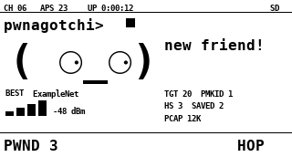

# esp32-pwnagotchi

A small WiFi companion for the **Waveshare ESP32-C6-LCD-1.47**. It watches
2.4 GHz WiFi, shows nearby networks on a Pwnagotchi-style landscape face, and
saves the material needed to audit WPA2-PSK networks: 4-way handshakes and
PMKIDs. It also learns the clients associated with each AP, so boost mode can
send a short unicast deauth to one real client instead of broadcasting to
everyone.

The face is the point. It looks left and right while scanning, smiles when it
meets a new AP, gets excited on a handshake, and falls in love with a PMKID.
The layout is 320x172 landscape and uses the same text faces and monospace
font as the original Pwnagotchi UI.



**Only use this on networks you own or have explicit written permission to
test.** Passive sniffing is one thing; boost mode sends deauthentication frames
and is active interference. Unauthorized use is illegal in Portugal and most
other places.

## Documentation

- [Hardware, pins, and controls](docs/hardware.md)
- [Serial protocol and JSON events](docs/serial-protocol.md)
- [Architecture and internals](docs/architecture.md)

## Hardware

- Waveshare ESP32-C6-LCD-1.47 (ESP32-C6FH8, 8 MB flash, 172x320 ST7789, used
  as 320x172 landscape)
- microSD card, FAT32, for the PCAP capture
- USB-C cable

The board has one 2.4 GHz radio. It cannot see 5 GHz and it listens to one
channel at a time. It is not a full monitor-mode adapter: it captures
management and data frames, but not control frames, and it can miss frames
under heavy load.

## What it does

- Passive beacon and probe-response scanning, with channel hopping.
- AP table with SSID, BSSID, channel, RSSI, security type, PMF state, and a
  skip flag.
- Client table with AP, channel, RSSI, age, and observation flags. Clients are
  learned from ordinary data frames and association requests, even when the
  payload is encrypted.
- WPA2 4-way handshake detection with EAPOL replay-counter validation
  (M1+M2 or M2+M3).
- PMKID detection from EAPOL message 1 and from the RSN IE of association
  requests.
- Hidden SSID resolution from association requests.
- PCAP capture to a new `/pwn_NNN.pcap` on the microSD card each boot, using
  radiotap headers with channel and RSSI.
- Live JSON events over USB serial.
- Pwnagotchi-style face with moods: scanning, happy, excited, in love, sleeping.
- Top bar with channel, AP count, uptime, and SD state.
- Middle status: strongest AP and RSSI, target count, client count,
  `HS n  SAVED n`, and PCAP size. `HS` is handshakes detected this boot.
  `SAVED` is handshakes confirmed written to the current session's PCAP.
- Bottom bar `PWND` counts saved handshakes plus saved PMKIDs.
- Optional boost mode: targeted unicast deauth to one learned client of the
  selected AP. Off by default. Requires an explicit target.
- Optional `boost broadcast on` keeps the old broadcast behavior for testing.
- Built-in skip list for networks that must never be targeted. `PrivateNet` is
  skipped by default.
- PMF-required APs are detected and boost refuses them because forged deauth
  frames are ignored.

It does **not** crack passwords on the board. It captures a hash and you crack
it offline with hashcat. A handshake is not a password.

## Repository layout

```text
firmware/pwnagotchi/   Arduino sketch, sniffer, display, generated faces
host/                  Python serial viewer and cracking helper
tools/                 Face bitmap generator
assets/                Font, license, preview images
docs/                  Hardware, protocol, architecture notes
```

## Build and flash

Arduino core `esp32:esp32@3.3.12` and the GFX library are assumed installed:

```sh
arduino-cli core install esp32:esp32@3.3.12
arduino-cli lib install "GFX Library for Arduino"
```

From the repository root:

```sh
FQBN="esp32:esp32:esp32c6:CDCOnBoot=cdc,FlashSize=8M,PartitionScheme=default_8MB"

arduino-cli compile --fqbn "$FQBN" \
  --build-property "compiler.c.elf.extra_flags=-zmuldefs" \
  --output-dir build firmware/pwnagotchi

arduino-cli upload -p /dev/cu.usbmodem101 --fqbn "$FQBN" \
  --input-dir build firmware/pwnagotchi
```

`-zmuldefs` is needed for boost mode. It lets the sketch's
`ieee80211_raw_frame_sanity_check` override win over the ESP-IDF library copy,
so `esp_wifi_80211_tx()` accepts deauth frames. Without it the firmware still
sniffs and captures, but `boost on` reports a TX error.

## Controls

- **BOOT short press**: toggle channel lock. Locked mode stays on the channel
  of the strongest non-skipped crackable AP. Unlocked mode hops channels 1 to 13.
- **BOOT long press**: pause or resume. While paused the face sleeps.

## Serial commands

Connect at 115200. The host tool auto-detects the Espressif USB port:

```sh
python3 -m venv .venv
.venv/bin/pip install -r host/requirements.txt
.venv/bin/python host/pwnagotchi.py
```

Commands (send them with `--cmd`, or type them into a serial monitor):

| Command | Meaning |
| --- | --- |
| `help` | list commands |
| `status` | one-line JSON statistics |
| `aps` | AP table with indices |
| `clients` | client table with indices |
| `skips` | SSIDs that are never targeted |
| `pcap` | PCAP path and size |
| `pause` / `resume` | stop or start sniffing |
| `hop` | channel hopping |
| `lock <1-13>` | lock a channel |
| `target <index>` | select an AP from `aps` |
| `raw <index>` | print the next raw beacon for an AP (parser debugging) |
| `boost on` / `boost off` | targeted unicast deauth to one learned client |
| `boost broadcast on` / `boost broadcast off` | legacy broadcast deauth, explicit |
| `clear` | reset detected HS/PMKID counters; `SAVED` follows the file |
| `selftest` | feed synthetic frames through the real parser |
| `demo hs` / `demo pmkid` / `demo happy` / `demo sleep` | show a face mood |
| `reboot` | restart |

Example session:

```sh
.venv/bin/python host/pwnagotchi.py --cmd aps --duration 3
.venv/bin/python host/pwnagotchi.py --cmd "target 4" --cmd "boost on"
```

`target` and `boost` are deliberately separate. Selecting a target only locks
the radio to its channel. `boost on` starts targeted unicast deauth to one
client learned on that AP, with 3 frames, a 5 second cooldown, and a maximum of
12 bursts. `boost broadcast on` is the old broadcast behavior and is explicit
only. Use either one only on networks you own or have written permission to
test. The built-in skip list (`skips`) is never targeted.

Boost stops automatically when the target handshake or PMKID is saved to the
PCAP. It also refuses targets that require PMF, because clients ignore forged
deauth frames there. `PrivateNet` is in the skip list by default. Edit
`SKIP_SSIDS` in `firmware/pwnagotchi/sniffer.cpp` to change the list.

## Capture and crack

Insert a FAT32 microSD card. Each boot creates a new `/pwn_NNN.pcap`, so a
reset or a host reconnect does not wipe the previous session. Pausing closes
the file; resuming reopens it in append mode, so a pause does not split the
session. The face shows `SD` in green when the card is mounted and the capture
is open. Remove the card after a session and copy the newest file to the laptop.

```sh
brew install hcxtools hashcat
hcxpcapngtool -o capture.22000 /Volumes/CARD/pwn_001.pcap
hashcat -m 22000 capture.22000 rockyou.txt
```

Or let the host tool do it:

```sh
.venv/bin/python host/pwnagotchi.py --crack /Volumes/CARD/pwn_001.pcap -w rockyou.txt
```

`hcxpcapngtool` prints how many hashes it extracted. PMKIDs are usually faster
to collect than full handshakes because only the AP's first EAPOL message is
needed, but not every AP includes a PMKID.

The display separates detected from stored. `HS` is the number of handshakes
detected this boot. `SAVED` increments only when the EAPOL frame that completes
a handshake is successfully written to the current PCAP. With no SD card,
`HS` can rise while `SAVED` stays 0. That is intentional.

WPA3-SAE is not covered by this workflow. A strong WPA2 passphrase will not
fall to a small wordlist. This is an audit tool, not a guarantee.

## How it works

- `firmware/pwnagotchi/sniffer.cpp` puts the C6 in promiscuous mode, hops
  channels, parses beacons and probe responses, recognises EAPOL key frames,
  tracks EAPOL message 1 to 4 with replay-counter validation, extracts PMKIDs
  from M1 and from association-request RSN IEs, learns client/AP pairs from
  data frames, and writes a radiotap PCAP (link type 127) to the card.
- The client table feeds targeted boost. The board sends a short unicast
  deauth burst to one active client, alternating AP to client and client to AP,
  then waits before trying again.
- `firmware/pwnagotchi/face.cpp` draws the landscape Pwnagotchi UI directly on
  the ST7789. It redraws only the face, status, top bar, and bottom bar, so
  the static paper background and rules do not flicker.
- `host/pwnagotchi.py` reads the JSON event stream and can run the cracking
  pipeline.

The PCAP contains beacons, probe responses, association requests, and EAPOL
frames, so `hcxpcapngtool` can recover SSIDs and PMKIDs. The capture is
intentionally small: one beacon per AP every 3 seconds, probe responses at
most every 500 ms. The file is flushed after each saved handshake or PMKID,
and at least every 5 seconds.

## Display and assets

- 320x172 landscape, near-white paper, near-black ink, thin rules, blinking
  cursor, and the Pwnagotchi top/bottom status layout.
- The faces are the exact strings from `pwnagotchi/ui/faces.py`: `AWAKE`,
  `LOOK_R`, `LOOK_L`, `HAPPY`, `EXCITED`, `FRIEND`, `SLEEP`, `BORED`.
- They are rendered at 45 px with `DejaVuSansMono-Bold`, the same font the
  original UI uses, and packed as 1-bit bitmaps in
  `firmware/pwnagotchi/face_assets.h`.
- Regenerate the assets after changing a face:

```sh
.venv/bin/pip install -r tools/requirements.txt
.venv/bin/python tools/gen_faces.py
```

The panel is mounted in landscape with `DISPLAY_ROTATION 1` in `config.h`.
If the image is upside down, change it to `3` and reflash.

The Pwnagotchi face strings come from
[evilsocket/pwnagotchi](https://github.com/evilsocket/pwnagotchi) (GPL-3.0).
The DejaVu font is under the Bitstream Vera license; the text is in
`assets/DejaVu-LICENSE.txt`. Keep those attributions if you redistribute the
project.

## Limitations and next steps

- 2.4 GHz only. The C6 has no 5 GHz radio.
- One channel at a time. Locking to the target's channel is much more reliable
  than hopping.
- Boost is manual and targets one AP and one client at a time. There is no
  automatic targeting loop.
- Broadcast deauth is still available as an explicit legacy mode, but it is
  less reliable than unicast.
- Some clients randomize their MAC address. The table keeps the associated
  MAC, which is stable for that session, but it can age out.
- No on-device cracking.
- No web UI yet. The serial protocol is the interface.
- A flash-backed capture fallback would let the board work without a microSD
  card. For now the card is required for PCAP.

## License

GPL-3.0. See [LICENSE](LICENSE) and [NOTICE](NOTICE) for the Pwnagotchi and
DejaVu attributions. The face expressions come from
[evilsocket/pwnagotchi](https://github.com/evilsocket/pwnagotchi) (GPL-3.0).
The DejaVu font is under the Bitstream Vera license; the text is in
`assets/DejaVu-LICENSE.txt`.

